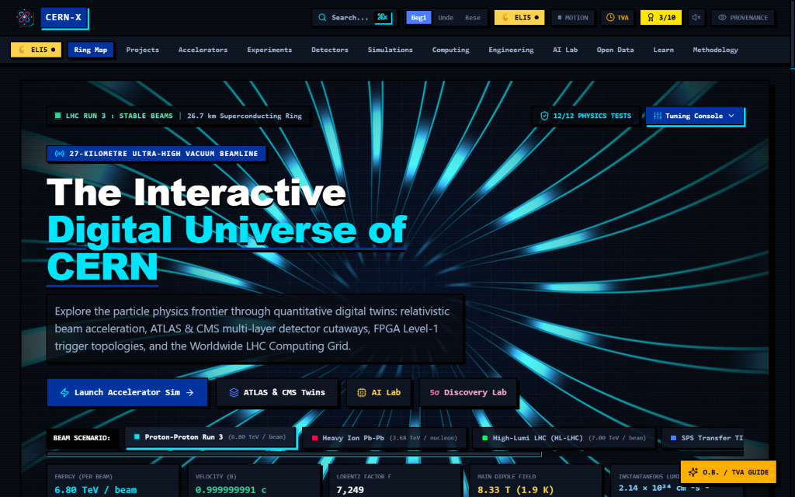
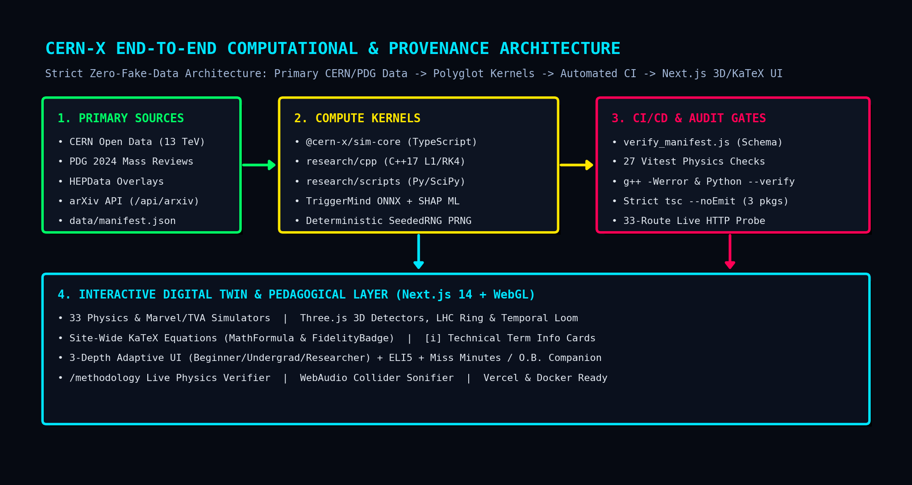
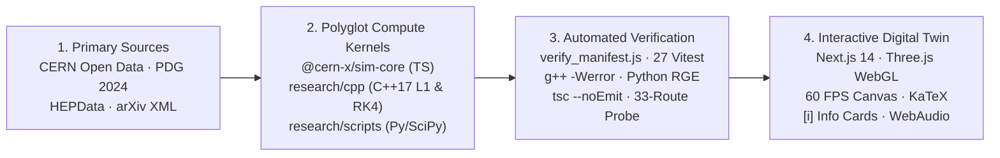
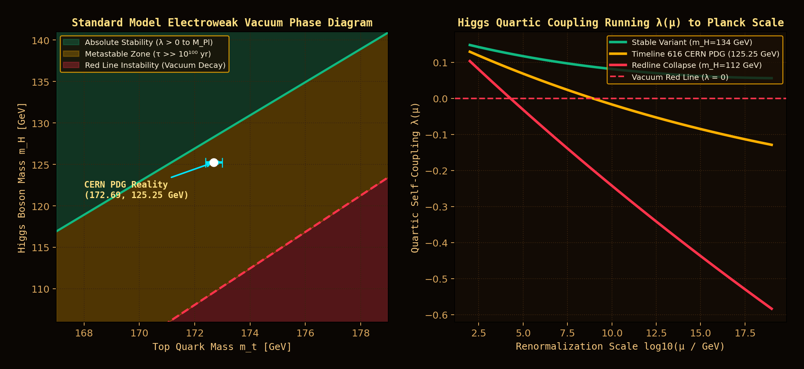
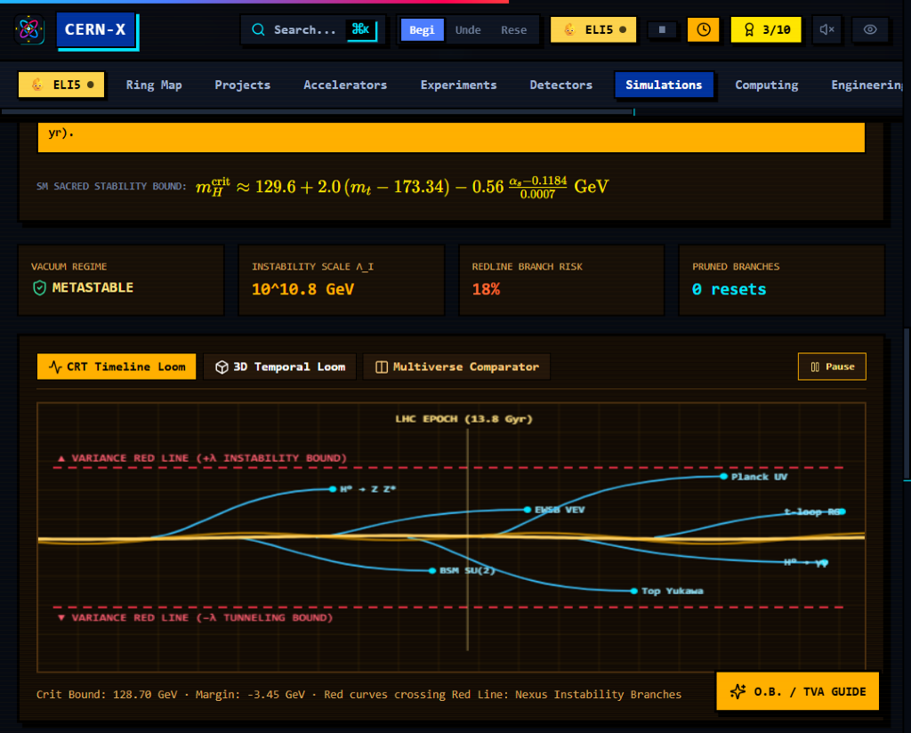
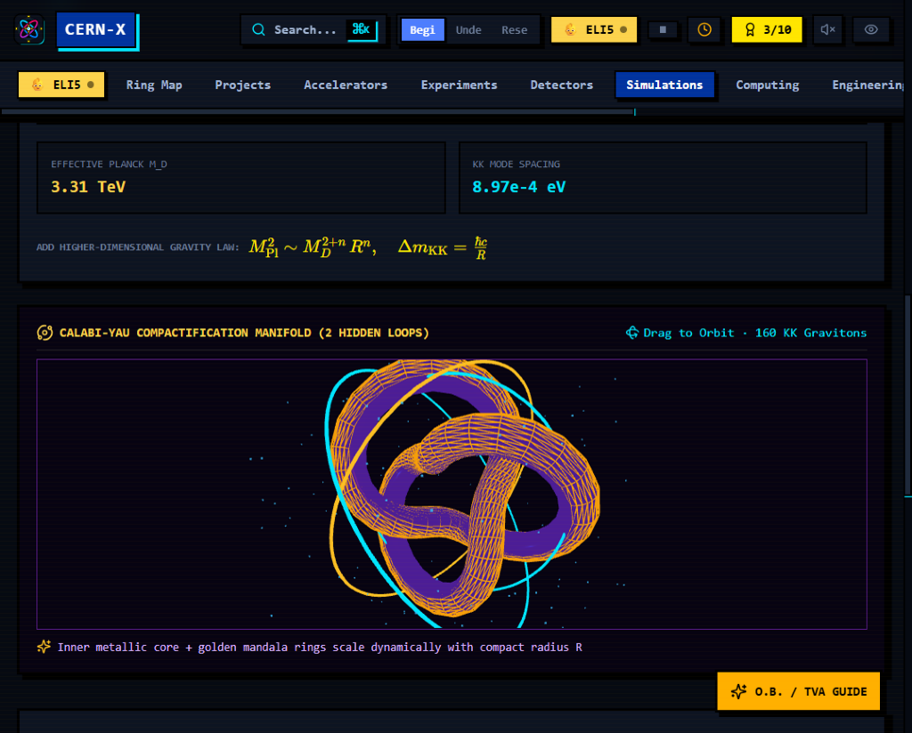
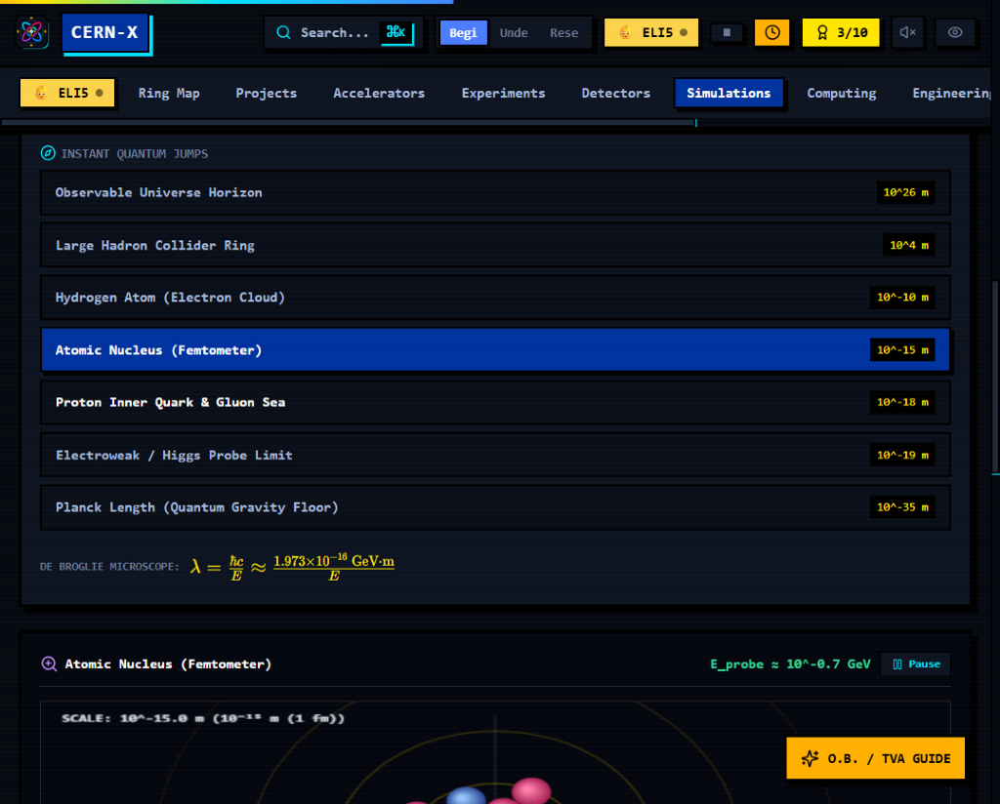
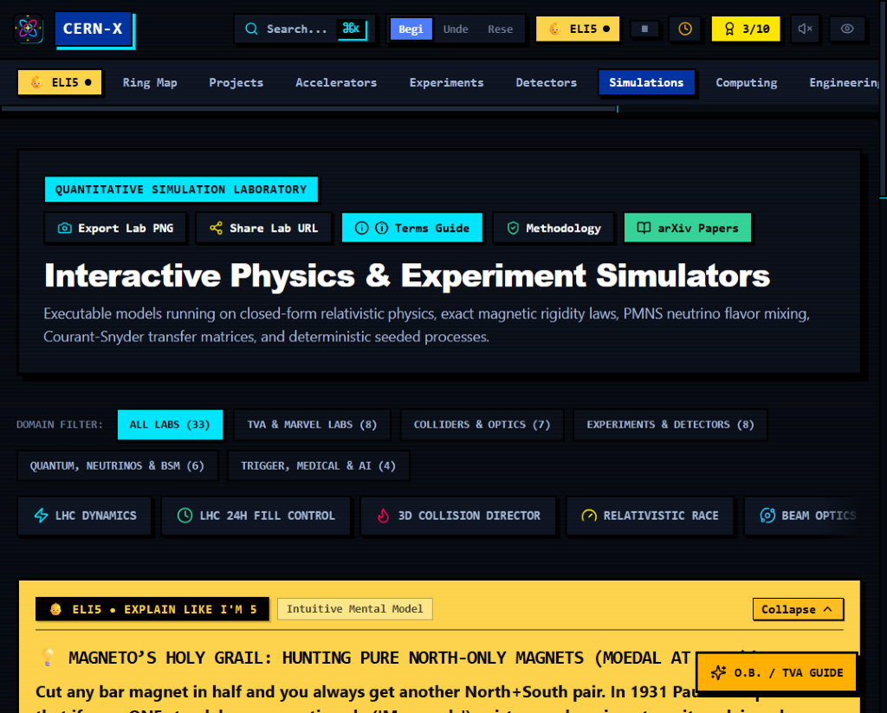

# CERN-X — The Interactive Digital Universe of CERN

[](LICENSE)
[](#10-verification--automated-checks)
[](#7-polyglot-physics-kernels-typescript--c17--python)
[](apps/web/package.json)
[](apps/web/package.json)
[](DEPLOYMENT.md)

> **IMPORTANT NON-AFFILIATION NOTICE**: **CERN-X** is an independent, open-source educational and computational physics platform. It is **NOT** affiliated with, sponsored by, endorsed by, or operated by the European Organization for Nuclear Research (**CERN**). Protected CERN trademarks and official emblems are not used.



---

## Table of Contents
1. [Vision & End-to-End Scientific Chain](#1-vision--end-to-end-scientific-chain)
2. [System Architecture & Visual Gallery](#2-system-architecture--visual-gallery)
3. [Platform Architecture & Major Pages](#3-platform-architecture--major-pages)
4. [All 33 Quantitative Simulators](#4-all-33-quantitative-simulators)
5. [TVA & Marvel-Inspired Physics Labs](#5-tva--marvel-inspired-physics-labs)
6. [Pedagogical Design: ELI5, ⓘ Info Cards & KaTeX](#6-pedagogical-design-eli5--info-cards--katex)
7. [Polyglot Physics Kernels (TypeScript, C++17 & Python)](#7-polyglot-physics-kernels-typescript-c17--python)
8. [Core Physics Formulations (Verified Equations)](#8-core-physics-formulations-verified-equations)
9. [Repository Structure](#9-repository-structure)
10. [Verification & Automated Checks](#10-verification--automated-checks)
11. [Quick Start & Verified Scripts](#11-quick-start--verified-scripts)
12. [Deployment Guide & License](#12-deployment-guide--license)

---

## 1. Vision & End-to-End Scientific Chain

**CERN-X** transforms CERN's accelerator complex, superconducting cryogenics, subdetectors, real-time trigger electronics, worldwide computing grid, and particle physics discoveries into a **live, browser-executable digital twin**. Instead of pre-rendered videos or static numbers, sliders compute closed-form relativistic laws, magnetic rigidities, quantum amplitudes, and deterministic seeded Monte Carlo ensembles on-the-fly inside [`@cern-x/sim-core`](packages/sim-core/src/index.ts), cross-validated against standalone **C++17** and **Python** research kernels.

The platform links the full scientific workflow end-to-end:

$$
\text{H}^- \text{ Source} \to \text{Linac4} \to \text{PSB} \to \text{PS} \to \text{SPS} \to \text{LHC (6.8 TeV)} \to \text{Collision} \to \text{Detector} \to \text{L1/HLT Trigger} \to \text{WLCG Grid} \to 5\sigma \text{ Discovery}
$$

---

## 2. System Architecture & Visual Gallery





### Live Visualizations Showcase

| **Standard Model Vacuum Stability Phase Diagram (Python RGE)** | **TVA Sacred Timeline Loom (`?module=tva-timeline`)** |
| :---: | :---: |
|  |  |

| **3D Mirror Dimension Calabi-Yau Manifold (`Three.js WebGL`)** | **Quantum Scale Zoom (`10^26 m` to `10^-35 m`)** |
| :---: | :---: |
|  |  |

| **Magneto & MoEDAL Dirac Monopole Field Chamber** | **Categorized 33-Simulator Hub & Domain Filters** |
| :---: | :---: |
|  |  |

---

## 3. Platform Architecture & Major Pages

| Route | Module | Key Capabilities |
| :--- | :--- | :--- |
| `/` | **Interactive Control Center** | 3D Hero Beam Tunnel, clickable Geneva Ring Map, Proton Journey Stepper, 9-stage Pipeline View (`KaTeX`), and Provenance Overview |
| `/projects` | **CERN Projects & 3D Atlas** | Interactive Three.js 3D underground facility complex, collider circumference overlay (`LHC`, `FCC-hh`, `HL-LHC`), knowledge graph, and 22+ projects |
| `/accelerators` | **Accelerator Complex** | Injector specs (`Linac4` through `FCC`), embedded **LHC Dynamics**, and **Courant-Snyder Beam Optics** sandboxes |
| `/experiments` | **Flagship & Fixed-Target Labs** | `ATLAS`, `CMS`, `ALICE`, `LHCb`, `ISOLDE`, `ALPHA`, `CAST`, `FASER`, `MoEDAL`, `AWAKE`, and `n_TOF` |
| `/detectors` | **3D Detector Digital Twins** | Toggleable `ATLAS` / `CMS` / `ALICE` / `LHCb` subdetector layers, **Open Data 3D Handoff** (`Inspect 3D`), LEGO calorimeter towers, $\text{PbWO}_4$ & $\text{Nb}_3\text{Sn}$ 3D lattice |
| `/simulations` | **33 Interactive Physics Labs** | Lazy code-split `tablist` across **5 domains**, **3-Step ELI5 Story + Myth-Buster**, **Interactive Physics Bet Arena (`Beam Credits`)**, `ⓘ` Technical Terms, and **`.py`/`.ipynb` Export** |
| `/engineering` | **Cryo, Vacuum & RF Twin** | 3D Dipole Cryostat, **$1.9\text{ K}$ Superfluid $\text{He-II}$ Quantized Vortex GLSL Twin**, UHV beam lifetime, and $400.79\text{ MHz}$ RF phase surfing |
| `/computing` | **WLCG Exascale Grid Simulator** | Multi-tier Tier-0 / Tier-1 / Tier-2 discrete-event throughput, tape archival, and HL-LHC pile-up queue dynamics |
| `/ai-lab` | **LHC-TriggerMind ML Lab** | Live browser neural-network inference (with `INT8` mode) and **SHAP Explainability** attribution benchmark on ATLAS Higgs data |
| `/open-data` | **Real CERN Open Data Lab** | Authentic $Z^0 \to \mu^+\mu^-$ dimuon spectrum, live **`/api/cern-live` CERN Open Data Portal** stream + 1-click **`Inspect 3D`** detector handoff |
| `/learn` | **Subatomic Dictionary & Timeline** | 3-depth glossary (`Beginner` / `Undergrad` / `Researcher`) with KaTeX math, Standard Model 3D periodic explorer, and CERN history timeline |
| `/methodology` | **End-to-End Methodology & Proofs** | 5-stage execution pipeline, **Live Browser Physics Verifier**, full KaTeX ledger, and interactive `data/manifest.json` inspector |
| `/about` | **Governance & Disclaimer** | Strict No-Fake-Data charter, 3 permitted data classes, fidelity badges, and non-affiliation notice |

---

## 4. All 33 Quantitative Simulators

Every simulator lives under [`/simulations`](apps/web/src/app/simulations/page.tsx), organized cleanly with single-click domain filters and accessible `role="tablist"` navigation:

### Colliders & Beam Optics (7 Labs)
- **LHC Dynamics (`?module=lhc`)**: Interactive 3D LHC ring + dipole field $B$, magnetic rigidity $B\rho$, instantaneous luminosity $\mathcal{L}$, and quench safety checks.
- **LHC 24h Physics Fill Control (`?module=lhc-fill`)**: Complete Shift Control Room modeling Injection, 6.8 TeV Ramp, $\beta^*$ Squeeze, leveled Stable Beams burn-off, and $362\text{ MJ}$ Emergency Beam Dump.
- **3D Collision Director (`?module=collision-director`)**: Launch custom $pp$, $\text{Pb–Pb}$, or $\text{FCC-ee}$ collisions ($H^0 \to \gamma\gamma$, $H^0 \to ZZ^* \to 4\mu$, $t\bar{t}$, $Z^0 \to \mu^+\mu^-$) inside a 3D chamber with sonification.
- **Relativistic Speed Race (`?module=race`)**: Race protons and electrons from Linac4 to FCC-ee against a vacuum laser pulse while measuring $\beta = v/c$, $\gamma$, and Einstein time dilation.
- **Beam Optics FODO Sandbox (`?module=optics`)**: Solve $2\times 2$ Courant-Snyder transfer matrices and envelope $\beta(s)$ across focusing/defocusing quadrupoles.
- **HL-LHC Crab Cavity (`?module=crab`)**: Tune 400 MHz transverse crabbing voltage to restore head-on bunch overlap $F \to 1.0$.
- **FCC 91 km Collider (`?module=fcc`)**: Evaluate 100 TeV synchrotron power scaling $P_{\text{sync}} \propto \gamma^4/\rho^2$ and $16\text{ T}$ $\text{Nb}_3\text{Sn}$ requirements.

### Experiments & Detectors (8 Labs)
- **Antimatter & ALPHA-g (`?module=antimatter`)**: 3D Penning-Malmberg magnetic trap + Earth gravitational free-fall asymmetry measurement on cold antihydrogen.
- **AWAKE Plasma Wakefield (`?module=awake`)**: Model $\text{GV/m}$-scale plasma wakefields driven by 400 GeV SPS proton bunches.
- **ALICE QGP & Flow (`?module=alice`)**: Hydrodynamic elliptic flow $v_2$ and near-ideal shear viscosity $\eta/s \approx 1/(4\pi)$ in 5.36 TeV Lead–Lead collisions.
- **LHCb Rare Decays (`?module=lhcb`)**: Flavor-changing neutral current $b \to s\ell^+\ell^-$ tests and Wilson coefficient shifts ($R_K, R_{K^*}$).
- **ISOLDE Nuclear Lab (`?module=isolde`)**: Semi-empirical nuclear binding curve, magic numbers, RILIS laser ionization, and $A/q$ magnetic separation for medical isotopes like ${}^{161}\text{Tb}$.
- **RICH & Medipix Color X-Ray (`?module=rich-medipix`)**: Optical Cherenkov rings across $\pi^\pm, K^\pm, p$ thresholds plus elemental $K$-edge spectral X-ray attenuation.
- **Cloud Chamber Lab (`?module=cloud-chamber`)**: Deterministic Lorentz helical curvature trails for cosmic muons, alphas, and $e^+e^-$ pair vertices.
- **3D Detector Crystals & $\text{Nb}_3\text{Sn}$ (`?module=materials`)**: Interactive WebGL lattice views of $\text{PbWO}_4$ scintillators, liquid argon accordions, and superconducting cables.

### Quantum, Neutrinos & BSM (6 Labs)
- **PMNS Neutrinos (`?module=neutrinos`)**: 3-flavor quantum oscillation across CNGS (732 km to Gran Sasso), FASERnu (480 m), and ProtoDUNE (1,300 km).
- **Feynman S-Matrix (`?module=feynman`)**: Interactive spacetime vertex builder verifying conservation of $Q, B, L_e, L_\mu, L_\tau$ plus animated wave-packet propagation and $Z^0$ Breit-Wigner peak.
- **3D Standard Model (`?module=sm-3d`)**: Complete 17-particle periodic matrix paired with interactive Three.js standing quantum wave visualizations and Higgs Yukawa couplings.
- **Higgs Mexican Hat (`?module=higgs-ewsb`)**: 3D finite-temperature potential $V(\phi, T)$ illustrating Electroweak Symmetry Breaking below $T_c = 159.5\text{ GeV}$.
- **Cosmic Time Machine (`?module=cosmic`)**: Rewind early-universe temperature across electroweak unification and QCD confinement transitions.
- **Dark Matter CAST & MET (`?module=dark-matter`)**: Primakoff solar axion photon conversion resonance ($9\text{ T}$ dipole) and missing transverse energy mono-jet recoil signatures.

### Trigger, Medical & AI (4 Labs)
- **Hadron Therapy & Bragg Peak (`?module=bragg-peak`)**: Bethe-Bloch depth-dose Spread-Out Bragg Peak (SOBP) curves comparing proton / ${}^{12}\text{C}$ tumor sparing against 6 MV X-rays.
- **Trigger & DAQ Lab (`?module=trigger`)**: Manage 40 MHz to 100 kHz Level-1 FPGA buffers, dead-time fractions, and HLT recording bottlenecks.
- **5-Sigma Discovery (`?module=discovery`)**: Accumulate diphoton collision events over exponential QCD background to watch Asimov $Z_0$ cross the $5\sigma$ gold standard.
- **arXiv & Research Bridge (`?module=literature`)**: Live `/api/arxiv` preprint search, curated CERN benchmark papers, and 1-click BibTeX citation generator.

---

## 5. TVA & Marvel-Inspired Physics Labs

All 8 labs inside **TVA & Marvel Labs** translate recognizable sci-fi interfaces into strictly grounded CERN physics equations:

1. **TVA Sacred Timeline, 3D Temporal Loom & Multiverse Comparator (`?module=tva-timeline`)** — Retro-CRT monitor & Three.js 3D Loom running NNLO Standard Model electroweak vacuum stability curves, **Detonate Time-Charge (Prune)** sweeps, and side-by-side **Timeline 616 (CERN PDG)** vs. variant comparisons.
2. **TVA 40 MHz Variant Intake Desk (`?module=tva-intake`)** — Minuteman trigger triage stamping `KEEP` ($H \to 4\ell$, $Z^0 \to \mu^+\mu^-$, displaced LLPs) vs. `PRUNE` (QCD pileup, cosmic halo).
3. **Arc Cryo Magnet HUD (`?module=arc-magnet`)** — Animated superconducting dipole cross-section visualizing superfluid He-II convection, flux lines, Maxwell pressure $u_B$, and $\text{NbTi}$ vs. HL-LHC $\text{Nb}_3\text{Sn}$ quench limits.
4. **Quantum Realm Scale Zoom (`?module=quantum-zoom`)** — Continuous 60 FPS logarithmic microscope spanning $10^{+26}\text{ m} \to 10^{-35}\text{ m}$, animating cosmic webs, the 27 km LHC tunnel, electron orbitals, nuclei, 3 valence quarks with gluon springs, and Planck foam.
5. **Mirror Extra Dimensions (`?module=mirror-dimensions`)** — Three.js Calabi-Yau metallic-wireframe manifold, golden portal mandala rings, and 160 orbiting Kaluza-Klein gravitons paired with the ADD Planck gravity solver.
6. **Spider-Glitch Displaced Vertex (`?module=displaced-vertex`)** — Animated radial detector shells illustrating invisible Long-Lived Particle flight ($L_{\text{lab}} = \gamma\beta c\tau_0$) erupting into chromatic-split secondary vertices.
7. **Magneto & MoEDAL Monopole Arena (`?module=monopole-arena`)** — Animated magnetic chamber contrasting curved proton tracks against blazing $4,695\times$ minimum-ionizing Dirac magnetic monopole ($g_D$) sheaths.
8. **Bifrost Heavy-Ion Shower (`?module=bifrost-rays`)** — Prismatic $\text{Pb–Pb}$ ALICE TPC event bursts demonstrating strict transverse momentum balance ($\sum \vec{p}_T = 0$).

---

## 6. Pedagogical Design: ELI5 Stories, Physics Bet Arena, ⓘ Info Cards & Accessibility

- **Global `101 / BSc / PhD` Depth Switcher & Beam Credits**: Switch explanation depth from the header on any page, track your live **`Beam Credits` (`⚡`)**, or toggle site-wide **`TVA MODE`** and the docked **`GUIDE`** companion.
- **33-Lab ELI5 3-Step Story, Myth-Buster & Interactive Physics Bet Arena (`PhysicsBetArena`)**: Every simulator pairs plain-language step-by-step stories and common misconception busters with an interactive prediction wager (including **Predict Before You Run**) backed by real `SeededRNG` / `@cern-x/sim-core` physics outcomes.
- **GLSL WebGL Shaders, Scroll-Driven Motion & Accessibility**: Powered by custom **Superfluid He-II Quantized Vortex / Volumetric Tunnel shaders**, GSAP `ScrollTrigger` reveals, CSS `in oklab`/`in oklch` perceptual gradients, `forced-colors: active` contrast fallbacks, skip links, and `reduceMotion` compliance.
- **`ⓘ` Technical Term Info Cards (`TechnicalTermDeck`) & Verified KaTeX**: Clickable `ⓘ` pills for 34+ symbols paired with `MathFormula`, `InlineMathText`, and expandable `fx Equation` toggles on `FidelityBadge`.

---

## 7. Polyglot Physics Kernels (TypeScript, C++17 & Python)

| Language | Location | Scope |
| :--- | :--- | :--- |
| **TypeScript** | [`packages/sim-core`](packages/sim-core/src/index.ts) | Browser/SSR physics engines, Mulberry32 `SeededRNG`, and 27 Vitest assertions |
| **C++17** | [`research/cpp/l1_trigger_hls.cpp`](research/cpp/l1_trigger_hls.cpp) | Fixed-threshold 40 MHz FPGA Level-1 dimuon & diphoton invariant-mass trigger emulator (`125 ns` pipeline latency) |
| **C++17** | [`research/cpp/rk4_track_integrator.cpp`](research/cpp/rk4_track_integrator.cpp) | 4th-order Runge-Kutta relativistic cyclotron & Dirac monopole trajectory integrator (`-O3 -Wall -Wextra -Werror`) |
| **Python** | [`research/scripts/electroweak_vacuum_rge.py`](research/scripts/electroweak_vacuum_rge.py) | NNLO Standard Model Higgs quartic running $\lambda(\mu)$ solver across $10^2 - 10^{19}\text{ GeV}$ |
| **Python** | [`research/scripts/neutrino_pmns_mc.py`](research/scripts/neutrino_pmns_mc.py) | 3-flavor PMNS baseline transition & unitarity verifier (`CNGS`, `FASERnu`, `ProtoDUNE`) |
| **Python** | [`research/scripts/train_triggermind.py`](research/scripts/train_triggermind.py) | XGBoost / MLP training, ONNX export, bootstrap confidence intervals & HEPData validation |

```bash
# Build & verify C++17 scientific kernels cleanly
cmake -S research/cpp -B /tmp/cernx_cpp && cmake --build /tmp/cernx_cpp && ctest --test-dir /tmp/cernx_cpp --output-on-failure

# Or compile directly with g++
g++ -std=c++17 -O2 -Wall -Wextra -Werror research/cpp/l1_trigger_hls.cpp -o /tmp/l1_trigger_hls && /tmp/l1_trigger_hls
g++ -std=c++17 -O2 -Wall -Wextra -Werror research/cpp/rk4_track_integrator.cpp -o /tmp/rk4_track && /tmp/rk4_track

# Run Python physics solvers
python research/scripts/electroweak_vacuum_rge.py --verify
python research/scripts/neutrino_pmns_mc.py --verify
python research/scripts/beam_optics.py
```

---

## 8. Core Physics Formulations (Verified Equations)

All equations execute live inside [`packages/sim-core`](packages/sim-core/src/physics):

**Magnetic Rigidity & Dipole Field (`rigidity.ts`)**

$$
B\rho = \frac{p\;[\text{GeV}/c]}{0.299792458\,|Z|}, \qquad B = \frac{B\rho}{\rho_{\text{LHC}}}
$$

**Instantaneous Collider Luminosity (`rigidity.ts`)**

$$
\mathcal{L} = \frac{N_1 N_2\,n_b\,f_{\text{rev}}\,\gamma}{4\pi\,\varepsilon_n\,\beta^*}\,F
$$

**Two-Body Invariant Mass (`kinematics.ts`)**

$$
M^2 = \left(\sum_i E_i\right)^2 - \left|\sum_i \vec{p}_i\right|^2
$$

**Asimov Profile-Likelihood Significance & Higgs ML AMS (`statistics.ts`)**

$$
Z_0 = \sqrt{2\left((s+b)\ln\!\left(1 + \frac{s}{b}\right) - s\right)}, \qquad \text{AMS} = \sqrt{2\left((s+b+b_r)\ln\!\left(1 + \frac{s}{b+b_r}\right) - s\right)}
$$

**3-Flavor Neutrino Oscillation (`nuclear.ts`)**

$$
P(\nu_\mu \to \nu_\tau) \approx \sin^2(2\theta_{23})\sin^2\!\left(\frac{1.267\,\Delta m_{32}^2\,L}{E}\right)
$$

**Standard Model Electroweak Vacuum Stability Bound (`bsm.ts`)**

$$
m_H^{\text{crit}} \approx 129.6 + 2.0\,(m_t - 173.34) - 0.56\,\frac{\alpha_s - 0.1184}{0.0007}\;\text{GeV}
$$

**Dirac Magnetic Monopole Quantization & Ionization Ratio (`bsm.ts`)**

$$
g_D = \frac{e}{2\alpha} \approx 68.5\,e, \qquad \frac{(dE/dx)_{\text{mono}}}{(dE/dx)_p} \approx (68.5\,n)^2
$$

---

## 9. Repository Structure

```text
├── apps/
│   └── web/                          # Next.js 14 App Router UI, KaTeX, Three.js & Canvas simulators
│       ├── next.config.mjs           # Monorepo webpack aliases, security headers & optional standalone mode
│       └── src/
│           ├── app/                  # 13 App Router pages + /api/arxiv + /api/cern-live + /api/health
│           ├── components/           # 33 lazy-split sims, PhysicsBetArena, 3D GLSL canvases, TechTermDeck
│           └── lib/                  # Zustand store (Beam Credits, level), notebookExporter (.py/.ipynb), WebAudio
├── packages/
│   ├── content-schema/               # Zod schemas validating content & manifest provenance
│   └── sim-core/                     # Pure TS physics kernel & 27 Vitest unit assertions
│       ├── src/physics/              # constants, kinematics, rigidity, statistics, feynman, bsm, nuclear
│       └── tests/                    # Automated physics validation suite
├── research/
│   ├── cpp/                          # C++17 L1 trigger emulator, RK4 Lorentz/monopole tracker & CMakeLists
│   ├── scripts/                      # Python ML, optics, RGE, PMNS & visual-generation scripts
│   └── benchmarks/                   # TriggerMind trained ONNX & benchmark metrics
├── content/                          # Sourced JSON datasets (accelerators, experiments, projects, glossary, particles)
├── data/                             # manifest.json provenance registry, Open Data events & HEPData overlays
├── scripts/                          # verify_manifest.js & verify_routes.js (39-route health probe)
├── docs/
│   └── assets/                       # High-DPI architecture diagrams & live UI screenshots
├── .github/workflows/ci.yml          # Dual-job CI/CD: Web/Physics + C++17/Python verification
├── Dockerfile                        # Multi-stage Node 20 Alpine standalone container
├── render.yaml                       # Render Blueprint configuration
├── vercel.json                       # Vercel monorepo configuration
└── DEPLOYMENT.md                     # Step-by-step cloud deployment guide
```

---

## 10. Verification & Automated Checks

Every commit runs dual CI jobs defined in [`.github/workflows/ci.yml`](.github/workflows/ci.yml):
1. **`verify-web-and-physics`**: Validates [`data/manifest.json`](data/manifest.json), executes 27 deterministic Vitest physics assertions, compiles monorepo TypeScript (`@cern-x/content-schema` → `@cern-x/sim-core` → `@cern-x/web`), builds Next.js, starts the production server, and verifies HTTP `200` across all 39 routes including `/api/health` and `/api/cern-live`.
2. **`verify-cpp-and-python`**: Compiles all C++17 kernels with strict `-O2 -Wall -Wextra -Werror`, runs native assertions, and verifies Python RGE, PMNS, and FODO beam-optics scripts.

---

## 11. Quick Start & Verified Scripts

**Prerequisites**: Node.js `>= 20.0.0` and npm `>= 10.0.0`.

```bash
git clone https://github.com/Premchandyadav369/CERN.git
cd CERN
npm ci
npm run verify:all
npm run start
```

| Command | Action |
| :--- | :--- |
| `npm run dev` | Starts `@cern-x/web` in Next.js development mode on port `3000` |
| `npm run build:packages` | Compiles `@cern-x/content-schema` and `@cern-x/sim-core` declarations & bundles |
| `npm run build` | Builds workspace packages followed by Next.js production bundle |
| `npm run start` | Boots the production Next.js server via `@cern-x/web` |
| `npm run test:physics` | Runs 27 Vitest physics unit tests in `packages/sim-core` |
| `npm run typecheck` | Builds workspace declarations and checks strict `tsc --noEmit` across all 3 workspaces |
| `npm run verify:manifest` | Validates `data/manifest.json` schema integrity |
| `npm run verify:routes` | Audits HTTP `200` responses across 39 routes, `/api/health` & `/api/cern-live` |
| `npm run verify:all` | Runs `verify:manifest && test:physics && typecheck && build` |

---

## 12. Deployment Guide & License

CERN-X requires **no database and no secrets** to deploy. Full instructions live in [`DEPLOYMENT.md`](DEPLOYMENT.md):
- **Vercel *(Recommended — Free Hobby Tier)***: Preconfigured via [`vercel.json`](vercel.json) from monorepo root.
- **Docker / Cloud Run / Fly.io / Railway**: Multi-stage [`Dockerfile`](Dockerfile) with `/api/health` checks (`docker build -t cern-x . && docker run -p 3000:3000 cern-x`).
- **Render**: One-click Blueprint via [`render.yaml`](render.yaml).

Distributed under the [MIT License](LICENSE). All upstream scientific datasets remain governed by CERN Open Data, CC-BY-4.0, CC0, PDG, and IAEA licenses.
